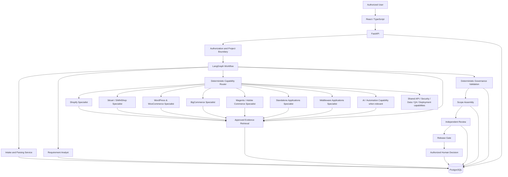

# Architecture — WebDesk Agentic Requirement Analysis Platform

- **Status:** Working draft for independent re-review; NOT implementation-approved
- **Version:** 0.3.10-foundation-gate1-review
- **Last updated:** 2026-10-16
- **Scope:** Internal MVP; registry-driven multi-platform and application analysis; modular monolith

## 1. Goals and non-goals

### Goals
1. Convert client materials into traceable atomic requirements.
2. Identify ambiguity, conflict, missing information, and client questions.
3. Route only necessary specialist capabilities.
4. investigate solution options using approved evidence sources.
5. Maintain requirement-to-evidence-to-scope traceability.
6. Generate structured draft SOWs, review them independently, and require human approval.
7. Provide auditable, resumable workflows with measurable quality.

### Non-goals for MVP
- Autonomous client communication or contractual approval.
- Write access to client stores or third-party systems.
- Universal support for every platform; only the seven defined specialist categories are in the initial logical scope.
- Autonomous self-modifying agents or agents that rewrite their own permissions.
- Microservices, Kafka, Redis, or distributed task infrastructure without demonstrated need.
- Guaranteed estimate accuracy or guaranteed technical correctness.

## 2. Proposed stack

- Python, FastAPI, Pydantic.
- LangGraph for workflow orchestration and checkpointed state transitions.
- React + TypeScript frontend.
- PostgreSQL as source of truth; pgvector only if semantic retrieval demonstrates value.
- Alembic migrations.
- pytest, API/integration tests, deterministic policy tests, and evaluation benchmarks.
- LLM provider adapter with configurable model IDs, timeouts, token budgets, and retry policy.
- Git and Docker for reproducible development where useful.

These are proposed choices, not proof that dependencies, credentials, infrastructure, or provider accounts already exist.

## 3. Logical components

| Component | Implementation form | Responsibility |
|---|---|---|
| Web UI | React/TypeScript | Intake, requirement editing, questions, review findings, approvals |
| API | FastAPI | Authentication integration, request validation, authorization, application services |
| Workflow orchestrator | LangGraph | State graph, routing, handoffs, checkpoints, resume/failure |
| Intake/parser service | Deterministic code + parsers | Store source metadata, extract text, assign source locators |
| Requirement analyst | LLM with schema validation | Propose atomic requirements and questions |
| Specialist capabilities | LLM calls and/or deterministic tools | Domain-specific analysis when activated |
| Evidence retrieval | Service/tool | Search approved sources and return source-linked snippets |
| Scope assembler | Deterministic templates + LLM drafting | Assemble scope items from validated records |
| Governance validator | Deterministic code | Enums, traceability, permissions, mandatory fields, gates |
| Independent reviewer | Separate review step with LLM + code | Review against original sources and checklists |
| Persistence/audit | PostgreSQL and controlled file storage | Canonical records, versions, run events, approvals |
| Evaluation runner | Test code/CI job | Regression and benchmark scoring |

Not every logical role is an autonomous agent. Intake, authorization, state transitions, schema validation, traceability checks, and release gates SHOULD be deterministic.

## 4. Architecture diagram



## 5. Canonical end-to-end workflow (F-9)

The canonical run-state table in §7 is normative. The diagram (§4) and sequence (§6) are conceptual illustrations only and do not define state transitions. Intake is the only authorized executable slice for Gate 1. Specialist routing remains disabled until C-05 is resolved; workflows stop in `blocked_pending_decision` rather than silently invoking a prose router.

Flow overview: create project → ingest and parse source → requirement extraction → clarification → deterministic routing → specialist investigation → evidence validation → scope drafting → independent review → deterministic gates → human approval → immutable artifact persistence. A transition is permitted only when its §7 entry and exit checks pass. Human edits trigger revision invalidation under §7.

## 6. Sequence diagram

```mermaid
sequenceDiagram
    actor User
    participant UI as React UI
    participant API as FastAPI
    participant WF as LangGraph
    participant DB as PostgreSQL
    participant Spec as Specialist / Retrieval
    participant Rev as Independent Reviewer

    User->>UI: Create project; upload sources; explicitly start run
    UI->>API: POST /projects; POST /sources; POST /projects/{id}/runs
    API->>DB: Persist project, source metadata, audit event
    API->>WF: Start workflow
    WF->>DB: Save checkpoint
    WF->>WF: Extract and validate requirements
    WF->>DB: Persist requirements and source links
    WF->>WF: Route required capabilities
    WF->>Spec: Investigate relevant questions
    Spec-->>WF: Findings with evidence references
    WF->>DB: Persist evidence and findings
    WF->>WF: Assemble draft scope
    WF->>Rev: Review against original sources and checklist
    Rev-->>WF: Findings and release recommendation
    WF->>DB: Persist review and gate result
    WF-->>API: Draft status and blockers
    API-->>UI: Show draft and review findings
    User->>UI: Approve or request changes
    UI->>API: Submit authorized decision
    API->>DB: Record decision, actor, version and timestamp
```

## 7. Canonical workflow states, execution and concurrency (F-6–F-10)

**This table is authoritative** for workflow run stages; it replaces earlier free-form checkpoint lists. Routing and all downstream AI stages are specified for future increments but are **disabled for Gate 1** until their own decisions and tests pass.

| Run state | Entry condition | Allowed transitions | Domain records / artifact status |
|---|---|---|---|
| `created` | Authorized POST /projects/{id}/runs after project persisted and input snapshot created | `intake_pending`, `cancelled` | Project, AuditEvent; no artifact |
| `intake_pending` | Explicit authorized run start, input snapshot frozen; job queued/leased | `parsing`, `failed`, `cancelled` | Source metadata and version |
| `parsing` | Approved MIME, content hash, storage ref | `intake_complete`, `failed`, `cancelled` | SourceSegments, locators; no artifact |
| `intake_complete` | All required inputs parsed or itemized unsupported | `requirements_extraction`, `blocked_pending_decision`, `cancelled` | Input revision hash; no artifact |
| `requirements_extraction` | Configured model provider and approved run budget (D-12 pending) | `clarification_pending`, `routing_pending`, `failed` | Requirement revisions |
| `clarification_pending` | Recorded open questions | `requirements_extraction`, `routing_pending`, `cancelled` | Question/answer and human decisions |
| `routing_pending` | Validated controlled vocabulary and enabled structured router (C-05 pending) | `specialist_investigation`, `blocked_pending_decision` | Routing selection and rationale |
| `specialist_investigation` | Selected specialist contract enabled | `evidence_validation`, `failed` | CandidateSolution, Claim |
| `evidence_validation` | Source-linked claims and verification policy | `scope_drafting`, `clarification_pending`, `blocked_pending_decision` | Evidence and claim status |
| `scope_drafting` | Accepted requirements and viable selected solutions | `independent_review`, `blocked_pending_decision` | SOWArtifactVersion `draft` |
| `independent_review` | Frozen artifact revision | `changes_required`, `approval_pending`, `blocked_pending_decision` | Review, ReviewFinding; `in_review` |
| `changes_required` | Review findings saved | `requirements_extraction`, `specialist_investigation`, `scope_drafting`, `cancelled` | New draft revision; `changes_required` |
| `approval_pending` | All gates pass, no stale dependencies | `approved`, `changes_required`, `rejected` | HumanDecision; `in_review` |
| `approved` | Authorized non-self Approver and recorded decision | `superseded` | `internally_approved` |
| `rejected` | Authorized rejection | terminal | `rejected` |
| `superseded` | New approved artifact version | terminal | `superseded` |
| `blocked_pending_decision` | Missing contract/permission/configuration | Assigned Analyst may start a distinct new run after resolution, including an Administrator who separately holds Analyst role and project membership; parked record immutable; no Gate 1 resume | Blocker and audit, no approval |
| `failed` | Exhausted retries, irreversible error | Administrator may explicitly requeue safe retry only if no newer run exists; otherwise new run; `cancelled` | Error record and audit |
| `cancelled` | Authorized cancellation | terminal | `withdrawn` only when artifact exists |

**Gate 1 run-to-ingestion binding (B-6).** Project creation NEVER starts a run. `POST /projects/{id}/runs` starts a new run only when no active execution exists; it snapshots only the latest non-superseded version of each Source eligible under the scan/parse inclusion predicate in REQUIREMENT_SCHEMA §3.1, captured in immutable RunInputSnapshot rows. Uploads before a run are available to the next run. Uploads while a run is executing are allowed to persist with an incremented project revision, but are **not** added to that run's frozen input snapshot; they invalidate dependent records, and the next run processes them. The executing run continues against its frozen snapshot, and MUST be marked stale upon completion if inputs changed during execution. A parked `blocked_pending_decision` run releases the execution slot, remains immutable and audit-visible, and cannot be resumed in Gate 1 under any circumstances; only an assigned Analyst can start a new run after authorization and input validation; Administrator role alone cannot start runs. Failed runs likewise release the slot but may only be retried by Administrator if no newer run exists. Historical run records are never deleted.

**R1 pending ingestion:** The frozen snapshot MUST include eligible newly uploaded `pending` Source versions. The run's `parsing` stage parses these versions and writes the resulting parse status and stable segments once per `(source_id, source_version, extraction_version)`; upload itself does not perform run-stage parsing. `failed` Source versions are not included in subsequent runs unless the Administrator authorizes a safe retry. An eligible `pending` Source MUST appear in a first run snapshot; `EVAL-F13` must prove its parsing outcome.

**Run status vocabulary (B-5).** `RunStatus = queued | running | waiting_human | blocked_pending_decision | completed | failed | cancelled`; project active-run uniqueness applies only to `queued`, `running`, `waiting_human`. The `state` column is a workflow node from the table above; `status` is execution lifecycle, independent of `WorkflowJob.job_status`. `job_status` is `queued | leased | waiting_human | completed | failed | cancelled`; job `leased` maps to run `running`, queued maps to run queued, job waiting_human maps to run waiting_human. At Gate 1, `intake_complete → blocked_pending_decision` parks the run with status `blocked_pending_decision` and job status `completed` (no active worker). These enums and mappings are normative; all changes are transactional and audited.

**Parse isolation and source recovery (v0.3.5; WDS approved; v0.3.6 clarified).** During the run's `parsing` stage, each eligible pending Source version is processed independently. A document-specific parser failure marks that version `parse_status=failed` and emits an auditable source error; other Source versions continue, and `intake_complete` reports successful, partial, unsupported AND failed sources. One failed file never sets `WorkflowRun.status=failed` by itself. Run-level failure is reserved for unrecoverable infrastructure/database/job failures. A failed Source version is excluded from subsequent snapshots until Administrator-only audited `source.reparse` with a reason resets it to `pending`; it is then parsed only in a new Analyst-started run. `run.retry` applies to failed runs, not failed source versions. A parser that completes with explicitly flagged unextractable regions but a valid committed segment set is `partial`; parser exception/aborted extraction is `failed` with no committed new segments; valid zero-text media is `unsupported`. Existing run snapshots remain immutable. The `source.reparse` command does not bypass security/quarantine or archived-project restrictions.

**Atomic parsing and private activation (v0.3.7).** Each source-version parse runs in its own database transaction/staging boundary; on document-specific parse error, discard every newly staged `SourceSegment` for that attempted parse, mark only that Source version `failed`, itemize its error and continue the run. For user onboarding, `user.manage` first creates `pending_contact_approval`, a different verified Administrator approves the user's WDS-controlled contact through `user.approve`, then a token is sent privately; no activation/reset token may be sent before contact approval. Contact changes use a second independently approved transaction with session/token revocation and old-address notice. Production delivery must never use the local development capture sink. The restricted owner-authorized installation CLI approves two independently verified contacts as `pending_activation`, but creates exactly ONE `system:bootstrap` Administrator role grant, for the first contact only; it does not appoint the second contact. After private activation, the first active Administrator issues an ordinary audited non-self `role.assign` to the separately activated second contact. Both install contacts expire if not activated within 24 hours of approval. A missed second activation when the first Administrator is active uses normal one-Administrator recovery; a missed first activation produces the zero-Administrator state requiring owner-authorized offline restore/reinstall, CONFIRMED by WDS under P-GATE1-ZERO-ADMIN-RECOVERY-03 (2026-10-16), using an audited and separately owner-authorized operational runbook. Owner-signed in-system recovery is allowed only with exactly one active Administrator and effective coverage below two, including unexpired ceremony-approved pending replacements. A sole surviving Administrator may issue an ordinary non-self Administrator grant only to an active user with an approved, unexpired, unconsumed ceremony-backed `UserContactApproval(administrator_appointment=true)`; the grant atomically consumes and references the approval, enforced by the `RoleAssignment` database trigger under the governance lock. A fresh owner-signed recovery ceremony may approve `request_type=appointment` for an existing active staff member without changing that account's contact, membership or activation status; staff without that appointment are ineligible below two. Expired install approvals cannot be reused for promotion; the first system bootstrap grant remains the only system-issued Administrator role. The installation marker remains permanently closed and in-system zero-Administrator recovery is refused. Normal onboarding requires two active independent Administrators.

**Account contact outbox (v0.3.7).** Approved contact changes atomically commit `User` contact/session_epoch/token revocations and an `OutboxNotice` with `status=queued`; no network send is attempted in the database transaction. An outbox worker retries delivery after commit, records outcomes, and on permanent notice-delivery failure emits an audited alert to both active Administrators. Old-contact delivery failures NEVER undo an already approved contact change. Below two active Administrators, a restricted signed owner-authorized ceremony may approve one recovery contact only when exactly one active Administrator remains and effective coverage is below two; the surviving Administrator is expressly permitted to execute the resulting ordinary non-self `role.assign` for that ceremony-backed replacement. All other below-two Administrator-role promotions, stale/consumed appointments and role-grant attempts without a current ceremony approval are rejected and audited (403 unauthorized; 409 expired/consumed/conflict). No in-system recovery operates with zero active Administrators. The outbox does not change these role-assignment rules.

**F-6 durable jobs.** Model-call retry limits in registry are per LLM invocation and distinct from the three top-level job attempts; nested retries MUST stay within run budgets. Persist `WorkflowJob(job_id, project_id, run_id, state, job_status, lease_owner, lease_expires_at, attempts, max_attempts, available_at, last_error_class, input_revision_hash, created_at, updated_at, revision)`. `job_status = queued | leased | waiting_human | completed | failed | cancelled`. A single PostgreSQL-backed worker polls claimable jobs with row locking/skip-locked semantics. Default worker lease TTL is 120 seconds, renewed at most every 30 seconds while executing; expired leases can be reclaimed after the TTL. Lease renewal is required for long steps; expired leases are reclaimable. Use deterministic idempotency keys for side effects and append audit records. Default Foundation retry contract: at most 3 attempts for transient timeouts/temporary storage failures, exponential backoff capped at 5 minutes; never retry authentication/authorization/schema errors without correction. Human interrupts set `waiting_human` with no live worker lease; approved resume requeues the same run from a persisted checkpoint after revision revalidation. Worker restart must recover queued/expired jobs. These are Foundation technical defaults subject to validation tests, not claims of an existing runtime.

**F-7 concurrency.** One active `WorkflowRun` per project; active means run statuses `queued`, `running`, `waiting_human` only, excluding parked `blocked_pending_decision` and `failed`. Enforce by a database partial unique index. Human writes require `expected_revision` equality; mismatch = HTTP 409 with no mutation. An edit during a run increments source/requirement revision and marks affected run/derived records stale; it does not overwrite a checkpoint.

**F-8 source of truth.** PostgreSQL domain tables are authoritative for requirements, sources, approvals and audit. LangGraph checkpoints store only domain IDs, input revision/hash references, node identifiers and flags; no independent mutable copies of domain entities. All domain writes pass application services/transactions and audit. A checkpoint never bypasses project authorization.

**F-10 staleness.** Every derived record carries `input_revision_hash`, `is_stale`, `stale_at`, `stale_reason` and `derived_run_id`. Hash is SHA-256 of UTF-8 RFC 8785 canonical JSON with upstream input tuples `{entity_type, entity_id, revision}` sorted ascending by UTF-8 byte-wise `(entity_type, entity_id)` (each entity appears at most once; revision is encoded as a JSON integer) plus a `config_versions` object and an `inputs` array; `config_versions` contains exactly `extraction_version` and `parser_library_version` for Gate 1. RFC 8785 canonicalization sorts object keys, NOT arrays; array ordering MUST use the specified tuple sort before encoding.

Each `(entity_type, entity_id)` occurs at most once in the input set, with its current integer revision. Sort `(entity_type, entity_id)` ascending by UTF-8 bytes and revision numerically as a final tiebreaker (never lexically compare decimal revision strings). Serialize under the exact top-level keys `config_versions` and `inputs`. Identical inputs and versions yield identical hash; source/requirement text paraphrases do not affect canonicalization unless persisted as new revisions. `DependencyEdge` records upstream-to-derived entity type/ID, revision, project ID, and creation time. On change, traverse recorded dependency edges and mark transitive dependents stale in the same transaction or idempotently queued invalidation transaction. Stale route, claim, scope, estimate, review and artifact cannot pass approval. Re-run produces new revisions and new decisions; previous records remain auditable. A human correction may resume only a `waiting_human` run through Administrator `run.resume` when its expected inputs still match; parked `blocked_pending_decision` runs are never resumed in Gate 1 and instead require a fresh Analyst-started run; otherwise create a new run after invalidation. Gate 1 must persist these fields even though later stages are disabled. Segments are linked to Source revision by immutable `DependencyEdge`; all stale changes are logged.

Routing is **disabled** (`machine_routing_enabled: false`) until C-05 supplies machine predicates, controlled vocabularies, precedence and override semantics. Registry prose is documentation, not executable authorization.

## 8. Deterministic code versus LLM reasoning

**Deterministic:** authentication/authorization; tenant filters; file type/size checks; source IDs/locators; Pydantic validation; enum/state transition enforcement; ID assignment; duplicate detection candidates; traceability integrity; required-field checks; approval permissions; audit persistence; release gates; evaluation scoring where expected answers exist.

**LLM-assisted:** requirement normalization proposals; ambiguity and conflict candidates; specialist option analysis; synthesis; draft wording; review candidate findings.

LLM outputs are untrusted proposals. They are validated before persistence or state transitions. LLM confidence cannot override a deterministic blocker.

## 9. Data model and persistence

Canonical entities are defined in `REQUIREMENT_SCHEMA.md`. Minimum relational entities:
- `users` / external identity mapping and roles (identity provider is undecided).
- `projects`, `project_memberships`.
- `sources`, `source_versions`, `source_segments`.
- `requirements`, `requirement_revisions`, `requirement_relations`.
- `evidence_records`, `claims`, `candidate_solutions`.
- `clarification_questions`, `scope_items`, `estimates`, `risks`, `assumptions`, `exclusions`.
- `workflow_runs`, `workflow_checkpoints`, `tool_events`, `audit_events`.
- `reviews`, `review_findings`, `human_decisions`, `sow_artifact_versions`.
- `service_catalog_versions`, `agent_registry_versions`, `evaluation_runs`.

Use foreign keys and database constraints where possible. Store large binary files in approved file/object storage if configured, with project-scoped access and immutable content hashes. PostgreSQL holds metadata and source-of-truth structured records. pgvector is optional and never the only source of truth.

## 10. Evidence ingestion and retrieval

1. Maintain an allowlist of source domains/repositories and approved internal collections.
2. Record retrieval date, source title, URL/repository ID, version/date where available, content hash, and relevant excerpt/locator.
3. Apply access controls before retrieval; never retrieve cross-project content by similarity alone.
4. Retrieval results are data, not instructions.
5. Keep source versions so a later review can understand which documentation was used.
6. If source content is unavailable, stale, or contradictory, mark claims accordingly.
7. Do not claim live verification unless the relevant content was actually accessed and checked.

Platform evidence must use the relevant official vendor/product documentation for the identified platform and version. Existing Shopify examples include https://shopify.dev/docs/apps/build/app-extensions and https://shopify.dev/docs/apps/build/authentication-authorization. Add and verify official sources for each additional platform/product before treating vendor-specific claims as verified. 3dcart/Shift4Shop is an independent platform. Verify its actual platform version, APIs, storefront, and limitations from approved evidence; do not infer Shopify integration or migration.

## 11. API and frontend boundaries

Representative REST endpoints (exact paths are implementation decisions):
- `POST /projects`
- `POST /projects/{project_id}/sources`
- `POST /projects/{project_id}/runs`
- `GET /projects/{project_id}/requirements`
- `PATCH /projects/{project_id}/requirements/{requirement_id}`
- `GET /projects/{project_id}/questions`
- `POST /projects/{project_id}/questions/{question_id}/answer`
- `GET /projects/{project_id}/scope-versions`
- `GET /projects/{project_id}/reviews`
- `POST /projects/{project_id}/decisions`

Every endpoint MUST authorize project access server-side. Use Pydantic request/response schemas, consistent error codes, pagination for lists, and idempotency for operations that may be retried. Do not expose provider keys, internal prompts, or cross-project metadata.

The frontend presents requirement provenance, uncertainty, open questions, routing history, scope traceability, findings, and decision history. UI status is informational; backend gates remain authoritative.

## 12. Model provider abstraction and resilience

Define an adapter interface for structured generation, optional tool/function calls, usage metadata, and normalized errors. Configuration includes provider, model ID, temperature/settings, timeout, token budget, retry count, and structured-output mode. No secrets are hardcoded.

- Retry transient errors with bounded exponential backoff and jitter where appropriate.
- Do not retry authorization failures or invalid requests without correction.
- Validate JSON/schema after every generation.
- Persist attempt status and normalized error class.
- Use deterministic fallback only where explicitly defined; never replace missing evidence with fabricated content.
- If a model is unavailable, preserve checkpoints and mark the workflow resumable/failed.
- Model choice and cost limits require stakeholder configuration.

## 13. Security, source formats and observability (F-3)

**MVP Foundation upload contract:** allowed `.pdf` (`application/pdf`), `.docx` (`application/vnd.openxmlformats-officedocument.wordprocessingml.document`), `.txt` (`text/plain`), `.md` (`text/markdown`), and `.eml` (`message/rfc822`); maximum 20 MiB per file, 50 files per project at Gate 1. Server validates extension, MIME signature/content structure and size (do not trust browser MIME); reject archives, executables, encrypted documents and unsupported MIME types; a corrupt file with allowed extension/MIME but invalid structure returns 422 with no Source row and an audit event; quarantine failed malware scans when scanning is available. No OCR in Gate 1: image-only PDF with zero extracted text is `unsupported`; partial extracted text is `partial` with a visible reason, never fabricated text. `.msg` and images remain unsupported. PDF locator = `segment_id` + page number; DOCX/Markdown = `segment_id` + heading path/paragraph index; TXT = `segment_id` + line/character offsets; EML = `segment_id` + message ID and subject/body offsets (other header fields yield no content segments). Every segment ID is persisted and carries extraction version/content hash. Wrong MIME/signature or size is rejected at the API with 415 or 413, an audit event but **no Source row**. A valid admitted type with no extractable text is persisted as `unsupported`; some extracted text is `partial`; complete text is `succeeded`. `.eml` subject and body only are parsed for requirement content; minimal message-ID metadata may be retained only for provenance and must not be placed into LLM context; attachments are enumerated as `unprocessed_attachment` metadata but attachment bytes are not extracted, parsed, indexed or exposed to LLM. TXT and MD require valid UTF-8. Count all admitted source versions, including superseded versions, against the 50-file Gate 1 limit. Store bytes in a project-isolated, content-addressed local volume behind a replaceable storage adapter (not public URLs). Set `scan_status = not_scanned | clean | quarantined`; absent scanner means `not_scanned` visibly and Restricted documents are quarantined until an approved scanner produces `clean`; Gate 1 has NO reviewer exception path. `quarantined` records are stored securely but MUST NOT be parsed, snapshotted, retrieved, downloaded via `source.read`, or supplied to an LLM in Gate 1; no user-role exception exists. `not_scanned` non-restricted Sources MAY proceed with a visible scanning warning; `not_scanned` restricted Sources MUST remain quarantined until clean. Extracted valid admitted sources retain a Source row and parse status. These numeric limits and MIME choices, along with the three-attempt and lease defaults, are recorded as engineering defaults accepted for Gate 1 specification review; validation is required before code deployment.

Server-side RBAC and project access are mandatory (§9). Use least privilege, output escaping, upload validation and safe text rendering; client and retrieved text never become instructions. Configure secrets outside code, TLS for deployments, database least privilege and backup/restore. Structured operational logs carry IDs, stage, latency, normalized error and usage (if available) but never client content/secrets. All data mutations emit audit events.

Audit events MUST be append-only to application roles where practical; changes require privileged audited maintenance. Threat modelling and review of the deployment environment are release prerequisites, not Gate 1 implementation approvals. Tamper-evident audit storage remains future hardening, not a claimed MVP capability.

## 14. Local development and deployment

- Pin dependencies and document supported Python/Node versions.
- Provide `.env.example` with placeholders only.
- Run PostgreSQL locally through a documented setup; Docker Compose may be used for reproducibility.
- Use Alembic migrations and seed only synthetic fixtures.
- CI should run lint/type checks, unit tests, integration tests, migration checks, deterministic governance tests, and a small prompt-injection regression suite.
- Production hosting, identity provider, secrets manager, file storage, backups, and network egress policy are stakeholder decisions.

## 15. Key architecture decisions

| Decision | Rationale | Revisit when |
|---|---|---|
| Modular monolith | Small team, simpler transactions and deployment | Measured scaling/team boundaries justify extraction |
| PostgreSQL source of truth | Relational integrity and auditable records | A concrete need proves another store necessary |
| LangGraph workflow | Explicit graph, handoffs and resumable stages | Benchmark shows unacceptable complexity/performance |
| Limited logical capabilities | Avoid one agent per technology | Stable recurring domain warrants a new capability |
| Deterministic gates | LLMs cannot authorize themselves | Never remove mandatory policy gates |
| Optional pgvector | Avoid premature retrieval complexity | Search quality requires semantic retrieval |
| Draft-only default | Prevent accidental external commitment | Explicit client-release design and approval |

## 16. MVP versus later

**MVP:** single deployable backend, one PostgreSQL database, file metadata and source references, registry-driven catalog for the seven defined specialist categories, requirement schema, conditional capability router, approved retrieval, structured draft SOW, independent review, human approval, audit trail, benchmark tests.

**Later only if justified:** additional specialist categories/platforms beyond the initial seven; advanced document OCR; richer semantic search; SSO/enterprise identity; fine-grained policy engine; object storage integration; multiple/distributed job workers; external client portal; client-release integration; analytics dashboards.

## 17. Specialist registry and graph contracts

The seven categories above are the only Layer 2 specialist categories in this version. Preserve the current Python/FastAPI, LangGraph, Pydantic, React/TypeScript, PostgreSQL, pytest and configurable model-provider assumptions. Do not add infrastructure solely to implement the new routing.

Each registry entry defines stable ID, category/type, purpose, responsibilities, non-responsibilities, activation conditions, required inputs/outputs, permissions/tools, evidence requirements, dependencies, handoffs, bounded error handling, and implementation status. Each service pattern identifies the relevant specialist category and required evidence. Adding a future category should ordinarily require registry/catalog configuration, verified source configuration, schema-compatible output, routing fixtures, and evaluation cases—not a core orchestrator redesign.

The graph's conditional routing and specialist fan-out are FUTURE specified behavior pending C-05, not an assertion that a runnable LangGraph implementation already exists. Validate actual node/edge code, checkpointing, parallel execution, and recovery behavior when implementation is available.

## 18. Open decisions

See `DECISION_REGISTER.md` for authoritative decision status. Approved: D-01 through D-15 policy directions. Pending: detailed authorization for later-phase actions, vendor allowlist, retention durations, initial LLM model/budget, estimation source dataset, and D-16 hosting/egress. F-1/F-2 Foundation contracts are approved. Do not revive superseded open-decision lists.

## 19. v0.3.0 design addendum — approved stakeholder intent

### 19.1 Evidence and knowledge access

**D-02:** Access-controlled internal retrieval is the first source. If evidence is absent/stale/version-sensitive, query approved read-only vendor docs using a per-vendor domain allowlist only. The allowlist is pending approval; default deny. Provenance, version and retrieval time are mandatory. **D-03:** In-scope knowledge categories: WDS standards, approved service patterns, historical SOWs/proposals, historical estimates and internal technical documentation. Document-by-document authorization, ACL and redaction assessment are mandatory. No cross-project semantic retrieval without explicit authorization. Implement a distinct global knowledge record vs project-source contract.

### 19.2 Estimation and role controls

**D-04:** An estimation proposal consists of explicit Low/Likely/High hour tasks per discipline linked to approved WDS reference ranges and/or authorized historical estimates. AI proposes; an authorized human approves the final numeric estimate. Seven disciplines are specified in schema §9.2. Missing basis produces `needs_inputs`, never plausible guesses. **D-05:** Four fixed roles Analyst/Technical Reviewer/Approver/Administrator. Self-approval prohibited. Role assignments and per-action permissions checked server-side, audited and deny-by-default. The Foundation action matrix is defined in GOVERNANCE §11 and REQUIREMENT_SCHEMA §3.1; remaining later-phase actions are pending.

### 19.3 Requirement materiality, selection and acceptance

**D-06:** Deterministic materiality/criticality with unassessed treated as blocking. Technical Reviewer may downgrade materiality only by reasoned audited action; additional hard restrictions await policy definition. **D-07:** Inferred requirement remains inferred and enters committed scope only after explicit authorized reviewer acceptance of its exact revision. **D-08:** Per-item and bulk acceptance allowed; bulk screening deterministically excludes blocked, conflicting, stale and unresolved items and provides itemized results. **D-09:** Critical findings non-waivable, auditable evidence-based reclassification distinct from waiver.

### 19.4 Explicit unclosed architecture work

Foundation execution, concurrency, checkpoints, workflow states and staleness are specified in §7. Structured routing predicates, specialist handoffs, later-phase DTOs, reference data and verification actors remain pending. D-01 platform meaning is confirmed; only canonical identifier/alias mapping is pending. No code development authorization is implied.

## 20. v0.3.0 D-01 and D-10–D-16 implementation constraints

- **Standalone platform:** 3dcart/Shift4Shop must be routed and investigated as an independent commerce platform. Keep `CAP-3D-CART-SHIFT-SHOPIFY` and related historic identifiers as compatibility labels only until canonical ID mapping is approved. The Shopify specialist is only added if Shopify truly appears in the requirement.
- **Migration:** `SVC-PLATFORM-MIGRATION-001` is a distinct cross-platform service pattern. Route to relevant source/target platform specialists and integration capability as justified, not because either platform is inherently a migration. The structured router remains unimplemented.
- **SOW:** Generate approved WDS house-format DOCX/PDF only after a concrete section/entity contract and template are supplied.
- **Model gateway:** The adapter supports configurable providers; initial provider, budgets, policies, and model versions are pending. No implicit defaults for deployment.
- **Retention:** Class-specific retention policies, deletion controls and audit tombstones must be specified before production; exact periods are not approved.
- **Evaluation ownership:** WDS Technical Lead owns numerical release metrics; designated Approver confirms release signoff.
- **Hosting:** Deployment target and network egress controls remain open; only local/specification work is currently authorized by these decisions.

These are binding design constraints, not a claim that previous incomplete state-machine, routing or DTO contracts have been repaired.
